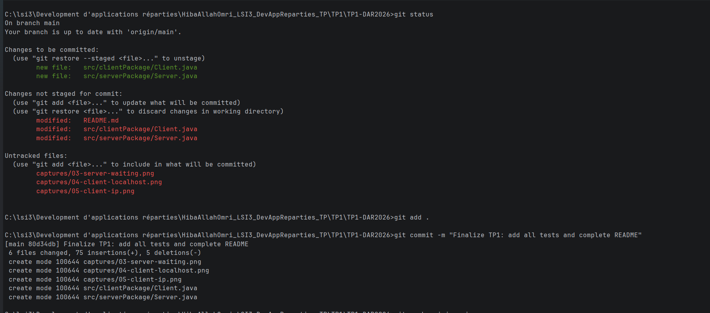
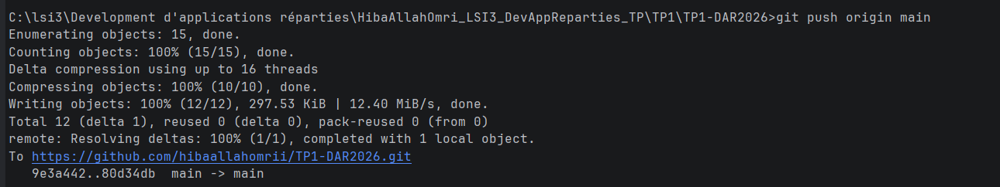
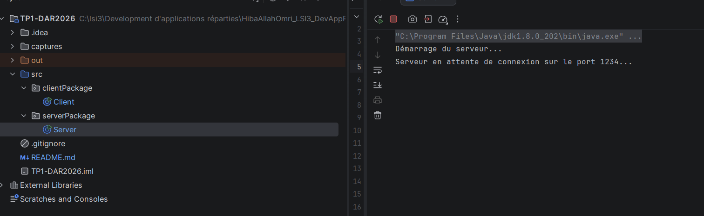
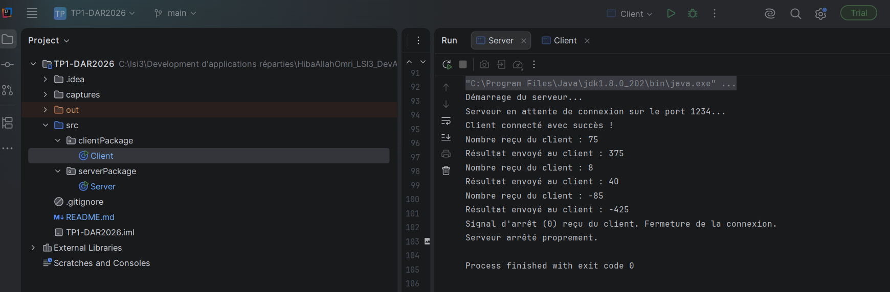
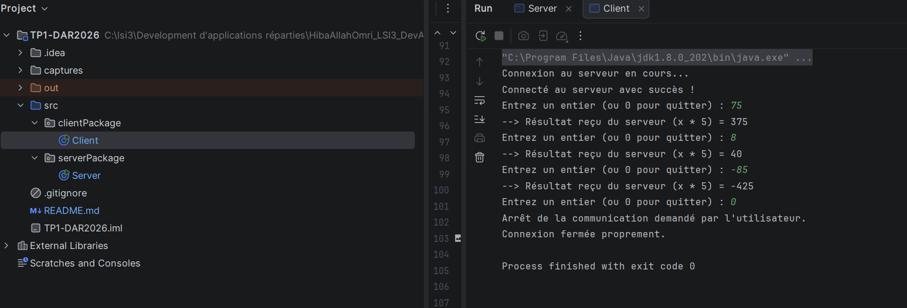
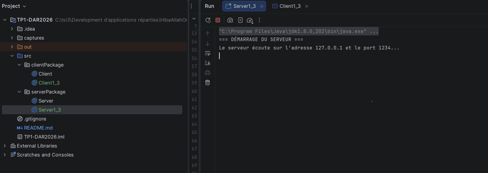
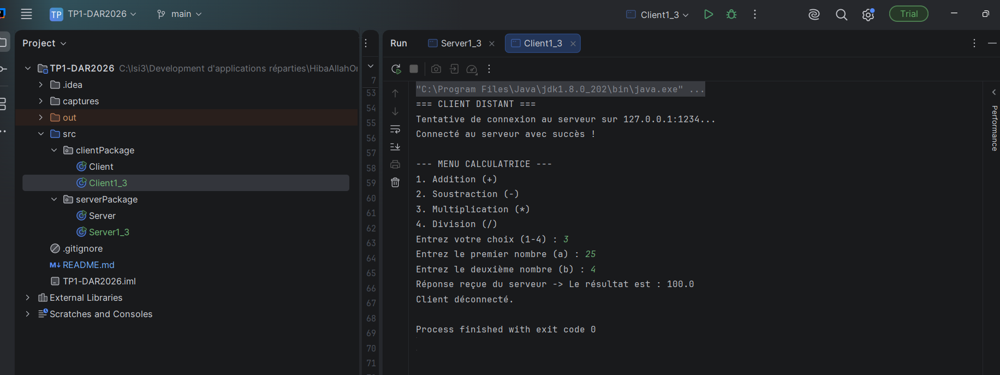
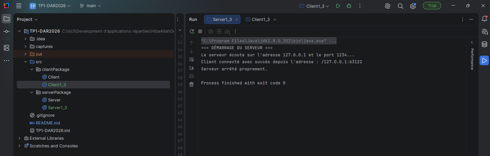

# TP1-DAR2026 — Les sockets en mode connecté TCP

---

# 📌Partie 1 : Activité 1-1 — Connexion de base Client / Serveur
## 1. Objectif du TP

L'objectif de cette activité est d'établir une première connexion entre une application cliente et une application serveur en Java, à l'aide des sockets en mode connecté TCP.

## 2. Environnement de travail

Les outils utilisés pour réaliser ce TP sont :

- Java JDK 8 ou supérieur
- IntelliJ IDEA
- Git

## 3. Étape 1 : Préparation de l'environnement Git

La commande `git --version` permet de vérifier que Git est installé et accessible depuis le terminal.

### Capture d'écran

Résultat : Git est installé et reconnu par le système.

## 4. Étape 2 : Préparation de l'environnement Java

Les commandes `java -version` et `javac -version` permettent de vérifier la version de Java et celle du compilateur Java.

### Capture d'écran

Résultat : Java 8 et le compilateur Java sont reconnus par le système.

## 5. Étape 3 : Création de l'application serveur

Dans cette étape, nous avons créé la classe `Server` dans le package `serverPackage` en utilisant un `ServerSocket` à l'écoute sur le port `1234`.

* **Résultat et Interprétation :**
  Après l'exécution du programme serveur, la console affiche le message d'attente. Cela indique que le serveur est démarré avec succès et qu'il est en état d'écoute active, en attente de la connexion d'un client.

### Capture d'écran

## 6. Étape 4 : Création de l'application cliente

Dans cette étape, nous avons développé la classe `Client` au sein du package `clientPackage` afin d'établir une communication TCP avec l'application serveur.

### Résultats et Captures d'écran

#### Test 1 : Connexion via `localhost`
* **Description :** Établissement de la connexion TCP entre l'application cliente et l'application serveur en utilisant le nom d'hôte textuel `localhost`.
* **Interprétation :** Le système d'exploitation traduit ce nom symbolique via le fichier de configuration local (`hosts`) pour pointer vers la machine locale, permettant ainsi au client de joindre le serveur sur le port `1234`.
* **Capture d'écran :**
  

#### Test 2 : Connexion via l'adresse IP `127.0.0.1`
* **Description :** Établissement de la même connexion TCP, mais en utilisant directement l'adresse IP numérique de boucle locale (`Loopback IP`) `127.0.0.1`.
* **Interprétation :** Le client communique directement avec l'interface réseau interne de la machine sans passer par une étape de résolution de nom, ce qui aboutit au même succès de connexion.
* **Capture d'écran :**
  

## 7. Étape 5 : Dépôt des livrables 

Le projet sera versionné avec Git et publié dans un dépôt nommé `TP1-DAR2026`. Le lien du dépôt sera déposé sur la plateforme ENT.

### Capture d'écran

## 8. Conclusion

Ce TP permet de vérifier l'environnement de développement, de créer deux applications Java et d'établir une première connexion TCP entre un client et un serveur.

# 📌 Partie 2 : Activité 1-2 — Service de Calculatrice

## 1. Objectif de l'activité
Étendre l'application Client/Serveur de l'Activité 1-1 pour y ajouter un service de calcul distant. Le client envoie un nombre entier au serveur, qui le multiplie par 5 ($x \times 5$) et renvoie le résultat. L'utilisation des classes `DataInputStream` et `DataOutputStream` permet de gérer efficacement les types primitifs (notamment les nombres négatifs).

## 2. Étape 1 : Préparation de l'espace de travail
- Réutilisation et mise à jour du projet Client/Serveur développé dans l'Activité 1-1 sous IntelliJ IDEA / Eclipse.
- Intégration des flux binaires (`DataInputStream` / `DataOutputStream`) dans les classes `Server.java` et `Client.java`.

## 3. Étape 2  : Description des applications

### A. Description du code du Serveur
Le serveur écoute sur le port `1234`[cite: 2] et utilise des flux binaires (`DataInputStream` / `DataOutputStream`) pour recevoir un entier, le multiplier par 5, renvoyer le résultat, et s'arrêter proprement si la valeur reçue est `0`.

### B. Description du code du Client
Le client se connecte au serveur, demande à l'utilisateur de saisir des entiers successivement via un clavier, les transmet au flux binaire, affiche le résultat reçu, et quitte la boucle lorsque l'utilisateur tape `0`.

# 4. Résultats et Tests

### A. Lancement et attente du Serveur
- **Résultat :** Le serveur démarre avec succès et se met en attente active des connexions sur le port `1234`[cite: 2].
- **Capture d'écran :**  
  

### B. Connexion et réception des requêtes par le Serveur
- **Résultat :** Dès le lancement du client, le serveur détecte la connexion, reçoit les différents entiers envoyés (positifs et négatifs), calcule les produits, et affiche les messages de confirmation en temps réel.
- **Capture d'écran :**  
  

### C. Session interactive globale (Côté Client & Arrêt)
- **Résultat :** Le client envoie des nombres positifs et négatifs traités correctement par le serveur, puis la communication s'arrête proprement lors de la saisie de `0`.
- **Capture d'écran :**  
  

## 5. Étape 3 : Dépôt des livrables (Activité 1-2)
- Le projet mis à jour a été versionné via Git et poussé sur le dépôt distant GitHub `TP1-DAR2026`.
- Le lien du repository a été déposé dans l'espace dédié de la plateforme ENT.

## 6. Conclusion générale du TP1
Ce TP a permis d'assimiler le fonctionnement des sockets TCP en Java, d'exploiter les flux de données binaires pour échanger des types primitifs, et de concevoir une application interactive dotée d'une gestion propre des connexions.

# 📌 Partie 3 : Activité 1-3 — Service de Calculatrice Amélioré

## 1. Objectif de l'activité

L'objectif de cette activité est d'améliorer le service de calculatrice en proposant quatre opérations arithmétiques : Addition, Soustraction, Multiplication et Division. L'utilisation des classes `InetAddress` et `InetSocketAddress` permet de configurer l'adresse IP et le port de communication pour une connexion locale ou entre deux machines distinctes.

## 2. Étape 1 : Préparation de l'espace de travail

- Réutilisation et mise à jour du projet Client/Serveur développé dans l'Activité 1-2.
- Création des classes `Server1_3.java` et `Client1_3.java` dans les packages `serverPackage` et `clientPackage`.
- Utilisation de `InetSocketAddress` pour configurer l'adresse réseau et le port de communication `1234`.

## 3. Étape 2 : Description des applications

### A. Description du code du Serveur

Le serveur écoute sur le port `1234` à l'aide de `ServerSocket` et `InetSocketAddress`. Il reçoit le choix de l'opération et deux nombres de type `double`, effectue le calcul demandé à l'aide d'une structure `switch` et renvoie le résultat ou un message d'erreur au client.

### B. Description du code du Client

Le client se connecte au serveur local ou distant, affiche un menu interactif permettant de choisir une opération et de saisir deux nombres, transmet les données via `PrintWriter`, puis reçoit et affiche la réponse à l'aide de `BufferedReader`.

## 4. Résultats et Tests

### A. Lancement et attente du Serveur

- **Résultat :** Le serveur démarre correctement et se met en écoute sur l'adresse IP configurée et le port `1234`.
- **Capture d'écran :**

### B. Exécution du Menu Interactif et Connexion du Client

- **Résultat :** Le client se connecte au serveur, affiche le menu des quatre opérations, récupère les valeurs saisies et les transmet au serveur.
- **Capture d'écran :**

### C. Réception du Résultat et Gestion des Erreurs

- **Résultat :** Le serveur effectue l'opération choisie et renvoie le résultat au client. Les erreurs, notamment la division par zéro et les choix de menu invalides, sont prises en compte.
- **Capture d'écran :**

## 5. Étape 3 : Dépôt des livrables (Activité 1-3)

- Le code source complet a été versionné avec Git et poussé sur le dépôt distant GitHub `TP1-DAR2026`.
- Le lien du dépôt a été déposé dans l'espace dédié de la plateforme ENT.

## 6. Conclusion générale du TP1

Cette activité a permis d'approfondir la communication Client/Serveur en Java avec TCP, de configurer les adresses réseau, d'utiliser les flux texte pour échanger des données et de réaliser quatre opérations arithmétiques tout en gérant les erreurs.

