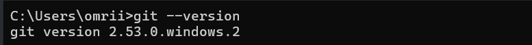
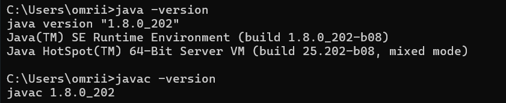

# TP1-DAR2026 — Les sockets en mode connecté TCP

## 1. Objectif du TP

L'objectif de cette activité est d'établir une première connexion entre une application cliente et une application serveur en Java, à l'aide des sockets en mode connecté TCP.

## 2. Environnement de travail

Les outils utilisés pour réaliser ce TP sont :

- Java JDK 8 ou supérieur
- IntelliJ IDEA
- Git

## 3. Étape 1 : Préparation de l'environnement Git

La commande `git --version` permet de vérifier que Git est installé et accessible depuis le terminal.

### Capture d'écran

Résultat : Git est installé et reconnu par le système.

## 4. Étape 2 : Préparation de l'environnement Java

Les commandes `java -version` et `javac -version` permettent de vérifier la version de Java et celle du compilateur Java.

### Capture d'écran

Résultat : Java 8 et le compilateur Java sont reconnus par le système.

## 5. Étape 3 : Création de l'application serveur

Cette partie sera complétée après la création du package `serverPackage` et de la classe `Server`.

### Capture d'écran

À ajouter après la création et l'exécution du serveur.

## 6. Étape 4 : Création de l'application cliente

Cette partie sera complétée après la création du package `clientPackage` et de la classe `Client`.

### Capture d'écran

À ajouter après la création et l'exécution du client.

## 7. Étape 5 : Dépôt des livrables 

Le projet sera versionné avec Git et publié dans un dépôt nommé `TP1-DAR2026`. Le lien du dépôt sera déposé sur la plateforme ENT.

### Capture d'écran

À ajouter après la publication du projet sur le dépôt distant.

## 8. Conclusion

Ce TP permet de vérifier l'environnement de développement, de créer deux applications Java et d'établir une première connexion TCP entre un client et un serveur.