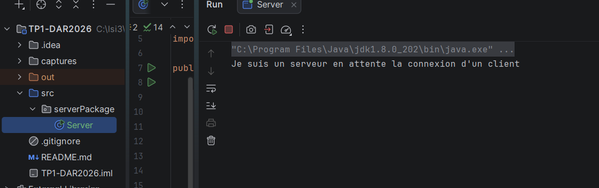
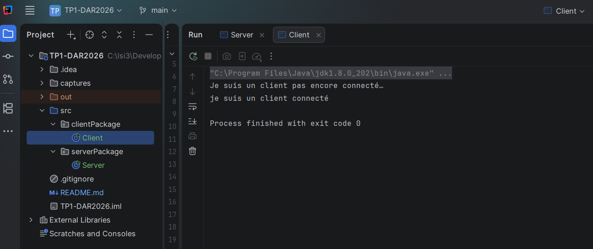
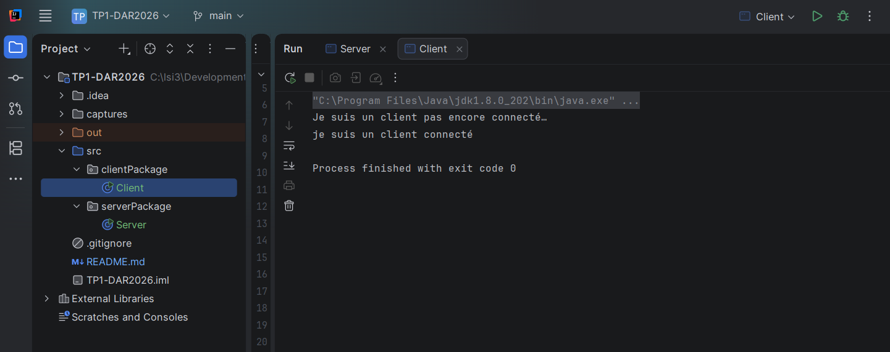

# TP1-DAR2026 — Les sockets en mode connecté TCP

## 1. Objectif du TP

L'objectif de cette activité est d'établir une première connexion entre une application cliente et une application serveur en Java, à l'aide des sockets en mode connecté TCP.

## 2. Environnement de travail

Les outils utilisés pour réaliser ce TP sont :

- Java JDK 8 ou supérieur
- IntelliJ IDEA
- Git

## 3. Étape 1 : Préparation de l'environnement Git

La commande `git --version` permet de vérifier que Git est installé et accessible depuis le terminal.

### Capture d'écran

Résultat : Git est installé et reconnu par le système.

## 4. Étape 2 : Préparation de l'environnement Java

Les commandes `java -version` et `javac -version` permettent de vérifier la version de Java et celle du compilateur Java.

### Capture d'écran

Résultat : Java 8 et le compilateur Java sont reconnus par le système.

## 5. Étape 3 : Création de l'application serveur

Dans cette étape, nous avons créé la classe `Server` dans le package `serverPackage` en utilisant un `ServerSocket` à l'écoute sur le port `1234`.

* **Résultat et Interprétation :**
  Après l'exécution du programme serveur, la console affiche le message d'attente. Cela indique que le serveur est démarré avec succès et qu'il est en état d'écoute active, en attente de la connexion d'un client.

### Capture d'écran

## 6. Étape 4 : Création de l'application cliente

Dans cette étape, nous avons développé la classe `Client` au sein du package `clientPackage` afin d'établir une communication TCP avec l'application serveur.

### Résultats et Captures d'écran

#### Test 1 : Connexion via `localhost`
* **Description :** Établissement de la connexion TCP entre l'application cliente et l'application serveur en utilisant le nom d'hôte textuel `localhost`.
* **Interprétation :** Le système d'exploitation traduit ce nom symbolique via le fichier de configuration local (`hosts`) pour pointer vers la machine locale, permettant ainsi au client de joindre le serveur sur le port `1234`.
* **Capture d'écran :**
  

#### Test 2 : Connexion via l'adresse IP `127.0.0.1`
* **Description :** Établissement de la même connexion TCP, mais en utilisant directement l'adresse IP numérique de boucle locale (`Loopback IP`) `127.0.0.1`.
* **Interprétation :** Le client communique directement avec l'interface réseau interne de la machine sans passer par une étape de résolution de nom, ce qui aboutit au même succès de connexion.
* **Capture d'écran :**
  

## 7. Étape 5 : Dépôt des livrables 

Le projet sera versionné avec Git et publié dans un dépôt nommé `TP1-DAR2026`. Le lien du dépôt sera déposé sur la plateforme ENT.

### Capture d'écran

À ajouter après la publication du projet sur le dépôt distant.

## 8. Conclusion

Ce TP permet de vérifier l'environnement de développement, de créer deux applications Java et d'établir une première connexion TCP entre un client et un serveur.